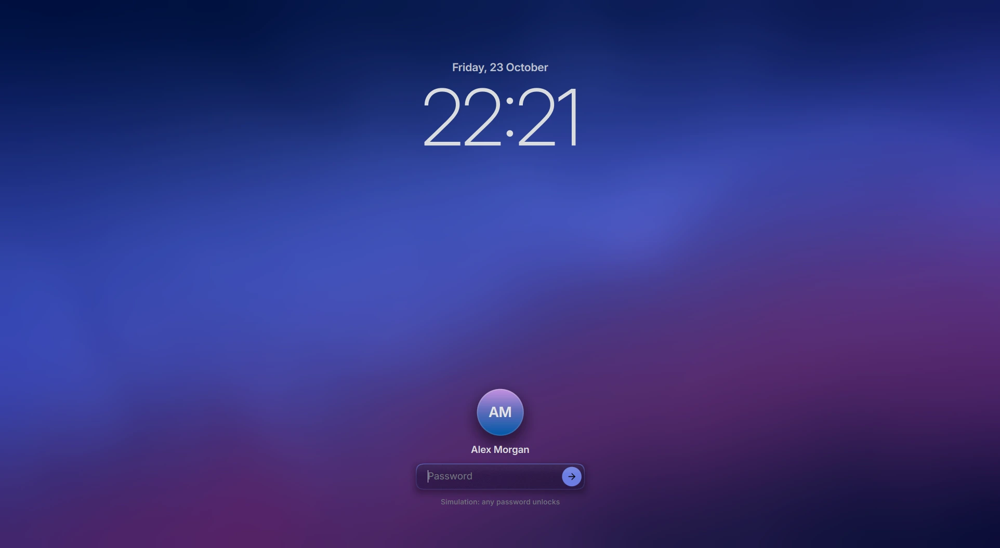
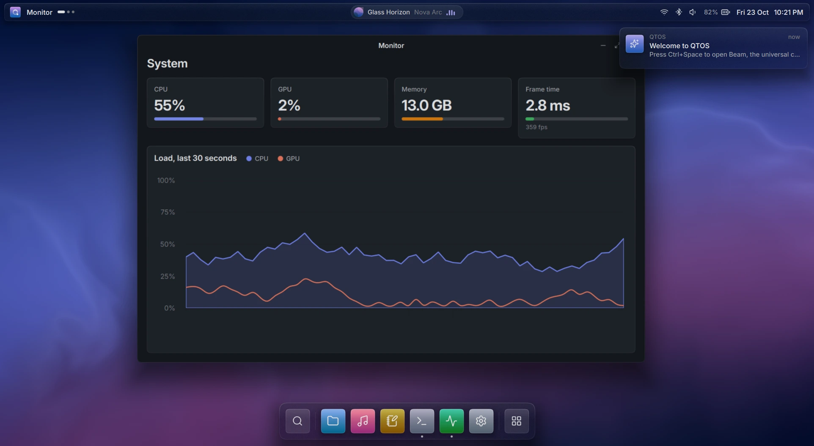

<div align="center">

# QTOS

**A next-generation operating system experience, built entirely with Qt 6.**

Prism compositor · Lumen design language · Qt Remote Objects services · Qt 6.12


</div>

QTOS is an operating system whose entire user-facing stack — compositor,
shell, system services, design system, apps and SDK — is built with Qt. It
runs on a Linux kernel with a small verified base; everything above the
"Qt Line" is Qt. See [**VISION.md**](VISION.md) for the full concept.

This repository contains **Phase 0: the complete Prism shell running in
simulation**, on Windows today and on any Qt 6.12 desktop, plus the
experimental Wayland compositor, platform integration for every Qt app, and
the image skeleton.

## Highlights

| | |
|---|---|
|  | **Beam**: one command bar for apps, actions, settings, files and arithmetic, with fuzzy ranking, a live preview pane and staggered spring entry. The glass refracts the windows behind it. |
|  | **Control Center**: every control is a live Qt Remote Objects binding to a system service: Wi-Fi, Bluetooth, Focus, appearance, Night Light, brightness, volume, media and accent. |
|  | **Overview and Spaces**: windows are live items in one Qt Quick scene, so they spring into an exposé grid at full frame rate while the wallpaper pulls focus. |
|  | **Lumen**: OKLCH tokens, so light/dark and the accent hue morph continuously through OKLab. Pictured: light appearance with a teal accent. |
|  | **Lock screen**: drawn by Prism above every client, with a variable-weight Inter clock and a focus-pull unlock. |
|  | **Apps**: Files, Music, Notes, Terminal, Monitor (Qt Graphs, passive frame-time probe) and Settings, built on QTOS.Kit and the Lumen Qt Quick Controls style. |
|  | **Sound and an audio-reactive interface**: a real-time audio engine plays generated QTOS Sessions and your own music with a five-band equaliser. The wallpaper, Now Playing and the Rail move with the music, at the intensity and in the frequency range you choose. |

**Performance** (8 s scripted tour of Overview, Beam, Control Center and Space
switches, 1539×844 logical at 125%, Direct3D 11):

| GPU | Average | p50 | p95 | p99 |
|-----|---------|-----|-----|-----|
| NVIDIA RTX 4060 Laptop, 360 Hz | **2.79 ms (358 fps)** | 2.77 ms | 3.07 ms | 3.57 ms |
| Intel UHD (integrated) | 7.30 ms (137 fps) | 8.20 ms | 9.11 ms | 11.36 ms |

When nothing changes, the shell renders nothing at all. See [docs/PERFORMANCE.md](docs/PERFORMANCE.md).

## Quick start (Windows)

Requirements: **Qt 6.12.0 for MSVC 2022 64-bit** (commercial; module list in
[docs/BUILDING.md](docs/BUILDING.md)), **Visual Studio 2022 Build Tools**
(C++ workload), **Python 3.10+**. CMake and Ninja come with Qt's tools.

```powershell
git clone https://github.com/QOR-MATRIX/QTOS.git
cd QTOS
.\tools\dev\build.ps1 -Test                 # configure + build + test (windows-release)
.\tools\dev\run.ps1                         # start on the lock screen (any password unlocks)
.\tools\dev\run.ps1 -- --unlocked --open files,music
```

Then try:

- <kbd>Ctrl</kbd>+<kbd>Space</kbd> to open Beam. Type `set`, `dark`, `12*12` or `glass`.
- <kbd>Ctrl</kbd>+<kbd>↑</kbd> for Overview, and <kbd>Ctrl</kbd>+<kbd>Alt</kbd>+<kbd>←</kbd> / <kbd>→</kbd> to switch Spaces.
- Drag a window to a screen edge to snap it, or double-click a title bar to maximise.
- Click the clock for Control Center, or the song in the Rail for Now Playing.
- Plug in a game controller (Xbox, PlayStation, Stratus and others) and accept the prompt to drive everything with it.
- Press play in Music, then open Settings › Sound to shape the equaliser and choose what the interface reacts to. Your own music (the Music folder, or `QTOS_MUSIC_DIR`) is queued after the generated sessions.

Drive the running system from another terminal:

```powershell
.\build\windows-release\qtosctl.exe status
.\build\windows-release\qtosctl.exe theme light
.\build\windows-release\qtosctl.exe accent 152
.\build\windows-release\qtosctl.exe notify "Build finished" "All tests passed"
.\build\windows-release\qtosctl.exe media play
.\build\windows-release\qtosctl.exe spectrum 10
```

## Repository map

| Path | What it is |
|------|------------|
| [`kit/`](kit/) | **QTOS.Kit**: Lumen tokens, `Theme`, `Spring`, OKLCH, SDF `Surface`, `Glass`, `Backdrop`, Aurora wallpaper, `Spectrum`, interface sounds, icons, fonts. [`kit/style/`](kit/style/): the **Lumen** Qt Quick Controls style |
| [`input/`](input/) | **QTOS.Input**: game controllers (XInput, HID, evdev) and the controller interface |
| [`audio/`](audio/) | The QTOS audio engine: real-time output, the QTOS Sessions synthesiser, music decoding, equaliser, limiter and analysis |
| [`services/`](services/) | System service contracts (`interfaces/*.rep`) and **QTOS.Services**, the typed replicas plus `Intents` that the shell and apps use |
| [`sim/`](sim/) | Simulated service implementations, scenarios, and the `qtos-simd` daemon |
| [`prism/`](prism/) | **QTOS.Shell** (`shell/`), the `qtos-shell` simulation host (`host/`), and the `prism` Wayland compositor (`compositor/`) |
| [`apps/`](apps/) | **QTOS.Apps**: Files, Music, Notes, Terminal, Monitor and Settings |
| [`platform/`](platform/) | Lumen `QStyle` for Qt Widgets, the `qtos` QPA platform theme, and a widgets gallery |
| [`image/`](image/) | `meta-qtos` Yocto layer and kas configuration (Phase 2) |
| [`sdk/`](sdk/) | App template and SDK notes |
| [`tools/`](tools/) | `qtosctl`, token generator, icon importer, screenshot capture, dev and CI scripts |
| [`tests/`](tests/) | C++ (Qt Test), QML (Qt Quick Test) and Python tests |
| [`docs/`](docs/) | Architecture, building, development, CI, performance, roadmap, design specs, ADRs |

## Documentation

- [VISION.md](VISION.md): the concept and long-term architecture
- [docs/ARCHITECTURE.md](docs/ARCHITECTURE.md): how the code fits together
- [docs/BUILDING.md](docs/BUILDING.md): toolchain, presets, running, troubleshooting
- [docs/DEVELOPMENT.md](docs/DEVELOPMENT.md): conventions, recipes, debugging
- [docs/design/LUMEN.md](docs/design/LUMEN.md) and [docs/design/SHELL.md](docs/design/SHELL.md): design specifications
- [docs/SERVICES.md](docs/SERVICES.md): service contracts, scenarios, `qtosctl`
- [docs/AUDIO.md](docs/AUDIO.md): the audio engine, analysis and the audio-reactive interface
- [docs/CONTROLLERS.md](docs/CONTROLLERS.md): game controllers and the controller interface
- [docs/QT-MODULES.md](docs/QT-MODULES.md): every Qt module and tool and its role in QTOS
- [docs/PERFORMANCE.md](docs/PERFORMANCE.md), [docs/CI.md](docs/CI.md), [docs/ROADMAP.md](docs/ROADMAP.md)
- [docs/adr/](docs/adr/): architecture decision records
- [CONTRIBUTING.md](CONTRIBUTING.md), [SECURITY.md](SECURITY.md), [CHANGELOG.md](CHANGELOG.md)

## Status

**Phase 0 · Foundations: complete.** Next: **Phase 1 · Nested Prism**, which
runs the compositor with real Wayland clients under WSLg and Linux. See
[docs/ROADMAP.md](docs/ROADMAP.md).

## License

Proprietary. Copyright © 2026 QOR-MATRIX. All rights reserved. See
[LICENSE](LICENSE). Built with Qt under a commercial license. Third-party
fonts and icons are listed in [THIRD_PARTY_NOTICES.md](THIRD_PARTY_NOTICES.md).
