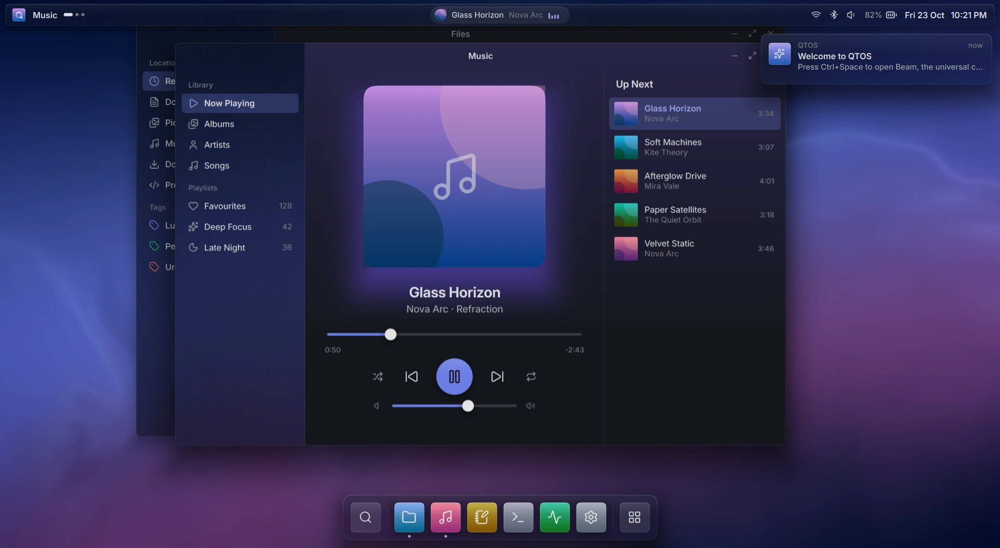
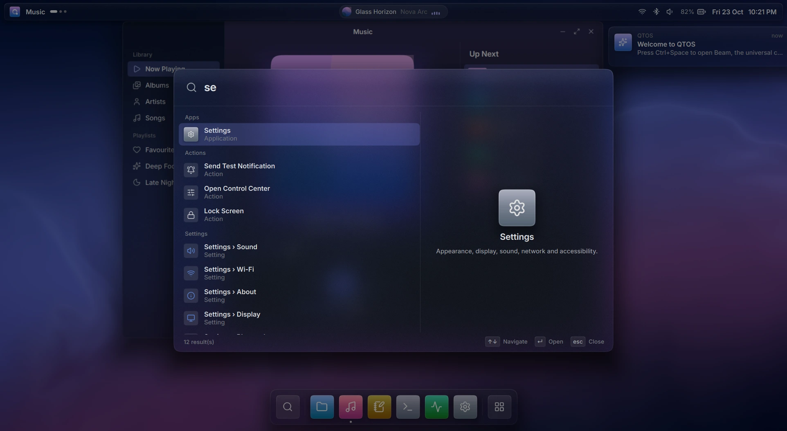
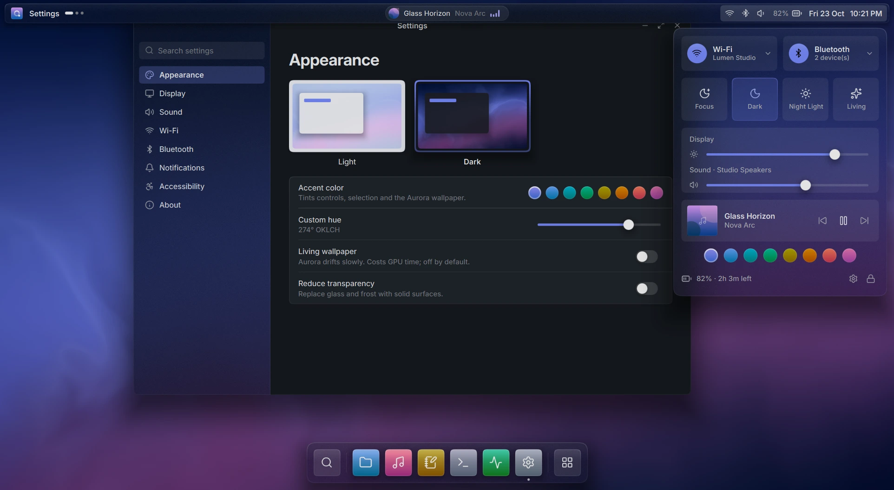
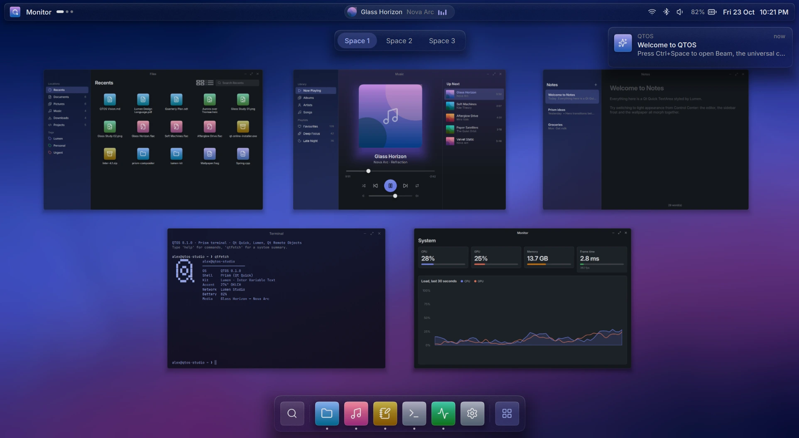
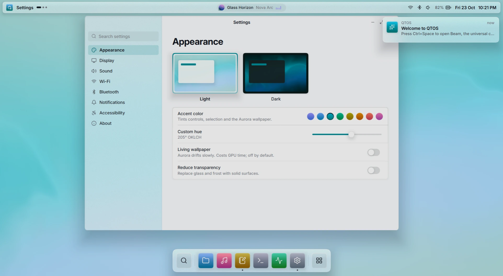
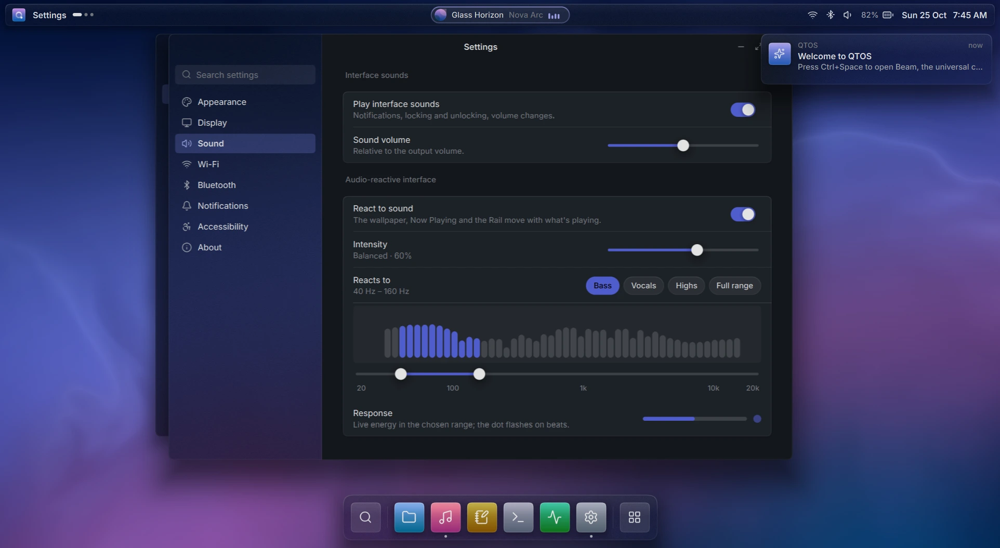

<div align="center">

# QOR OS

**The operating system for players, game makers and creators.**

Prism compositor · Lumen design · QQ engine · ARQADE · the QOR network · Qt 6.12



</div>

QOR OS is a Linux operating system whose whole experience is drawn by Qt. The
compositor and shell, the design system, the system services, the game engine
and its studio, the arcade, the media player and the account system are all
QOR OS's own. It joins two projects
([QOR-0002](docs/decisions/QOR-0002-one-repository-from-qtos-and-demiurge.md)):

- **QTOS**, the operating system QOR OS grew from, brings Prism, a Wayland compositor whose
  shell and windows share one Qt Quick scene, plus the Lumen design language,
  system services, controllers, audio and a signed Store.
- **Demiurge** is the QOR ecosystem. It brings the QQ game engine and QQ
  Studio, ARQADE, QOR Media, QOR ID, Social and the Rust core that holds the
  keys.

See [**VISION.md**](VISION.md) for the whole concept, and [OWNER.md](OWNER.md)
for where it stands today.

## Who it is for

What each kind of person gets in QOR OS 1.0
([QOR-0007](docs/decisions/QOR-0007-what-1-0-ships.md)).
[The roadmap](docs/ROADMAP.md) says which parts are built and which are
still to come.

| | |
|---|---|
| **Players** | A controller-first Home with every game in one Library: QQ games, ARQADE, and Steam through Proton. Each display runs at its own refresh rate, up to 360 Hz. Friends and chat sit over any game. |
| **Game designers** | QQ Studio builds lit 3D and pixel-perfect 2D worlds with physics, logic, sound and animation. An agent can help over MCP, using the designer's own key. |
| **Game developers** | QQ's runtime plays natively and in a browser. Games are published from the Studio, with a provenance record on the QOR network. |
| **App developers** | QOR.Kit, the Lumen controls, typed system services and a simulator that runs the whole shell on Windows. |
| **Creators** | Themes and widgets in the Store, versioning with Qontrol, and royalties that follow a remix once real value exists. |

## Highlights

| | |
|---|---|
|  | **Beam**: one command bar for apps, actions, settings, files and arithmetic, with fuzzy ranking, a live preview pane and staggered spring entry. The glass refracts the windows behind it. |
|  | **Control Center**: every control is a live Qt Remote Objects binding to a system service: Wi-Fi, Bluetooth, Focus, appearance, Night Light, brightness, volume, media and accent. |
|  | **Overview and Spaces**: windows are live items in one Qt Quick scene, so they spring into a grid at full frame rate while the wallpaper pulls focus. |
|  | **Lumen**: OKLCH tokens, so light and dark and the accent hue morph continuously through OKLab. |
|  | **Sound and an audio-reactive interface**: a real-time engine with a five-band equaliser; the wallpaper and the Rail move with the music. |
|  | **Prism**: the real Wayland compositor, with several displays, controllers and three-finger gestures, running real clients. |

**Performance:** an 8-second scripted tour of Overview, Beam, Control Center
and Space switches, at 1539×844 logical and 125% scaling, on Direct3D 11.

| GPU | Average | p50 | p95 | p99 |
|-----|---------|-----|-----|-----|
| NVIDIA RTX 4060 Laptop, 360 Hz | **2.79 ms (358 fps)** | 2.77 ms | 3.07 ms | 3.57 ms |
| Intel UHD (integrated) | 7.30 ms (137 fps) | 8.20 ms | 9.11 ms | 11.36 ms |

When nothing changes, the shell renders nothing at all. See
[docs/PERFORMANCE.md](docs/PERFORMANCE.md).

## Quick start (Windows)

Requirements:

- **Qt 6.12.0 for MSVC 2022 64-bit**, commercial; the module list is in
  [docs/BUILDING.md](docs/BUILDING.md);
- **Visual Studio 2022 Build Tools**, with the C++ workload;
- **Python 3.10+**;
- **Rust 1.91+**, for the QOR core.

CMake and Ninja come with Qt's tools.

```powershell
git clone https://github.com/QOR-MATRIX/qor-os.git
cd qor-os
.\tools\dev\build.ps1 -Test                 # the OS and the QOR core: configure, build, test
.\tools\dev\run.ps1                         # the shell in simulation, on the lock screen (any password unlocks)
.\tools\dev\run.ps1 -- --unlocked --open files,music
.\tools\dev\products.ps1                    # QQ, ARQADE and QOR Media: build and test
```

Then try:

- <kbd>Ctrl</kbd>+<kbd>Space</kbd> to open Beam. Type `set`, `dark`, `12*12` or `glass`.
- <kbd>Ctrl</kbd>+<kbd>↑</kbd> for Overview, and <kbd>Ctrl</kbd>+<kbd>Alt</kbd>+<kbd>←</kbd> / <kbd>→</kbd> to switch Spaces.
- Plug in a game controller (Xbox, PlayStation, Stratus and others) and accept the prompt to drive everything with it.
- Open QQ Studio (`build\products\qq\qq-studio.exe`) and play the Orb Run sample (`products\qq\samples\orb-run`).

On Linux, Prism runs as a real Wayland compositor nested in your session; see
[docs/BUILDING.md](docs/BUILDING.md#prism-the-wayland-compositor-linux).

## Repository map

| Path | What it is |
|------|------------|
| [`prism/`](prism/) | **Prism**: the shell (`shell/`, QOR.Shell), the `qor-shell` simulation host (`host/`) and the `prism` Wayland compositor (`compositor/`) |
| [`kit/`](kit/) | **QOR.Kit**: Lumen tokens, `Theme`, `Spring`, OKLCH, SDF `Surface`, `Glass`, `Backdrop`, Aurora wallpaper, icons and fonts. [`kit/style/`](kit/style/) is the **Lumen** Qt Quick Controls style |
| [`input/`](input/), [`audio/`](audio/) | Game controllers (XInput, HID, evdev) and the controller interface; the real-time audio engine |
| [`services/`](services/), [`sim/`](sim/) | System service contracts and **QOR.Services**; the simulated services and `qor-simd` |
| [`store/`](store/), [`apps/`](apps/) | The signed Store; first-party apps (Files, Music, Notes, Terminal, Monitor, Settings, Store) |
| [`platform/`](platform/) | Lumen `QStyle` for Qt Widgets, the `qor` platform theme, a widgets gallery |
| [`core/`](core/) | The **QOR core**, built from demiurge-chain at a pinned commit ([QOR-0003](docs/decisions/QOR-0003-the-qor-core-at-a-pinned-commit.md)) |
| [`products/qq/`](products/qq/) | **QQ**, the QOR Engine: runtime, QQ Studio, QQ Player, the agent's tools (from demiurge-chain, developed here since [QOR-0015](docs/decisions/QOR-0015-the-products-are-developed-here.md)) |
| [`products/arqade/`](products/arqade/) | **ARQADE**: the Qt app and its games (developed here), and their replay fixtures (carried) |
| [`tools/qor-media/`](tools/qor-media/) | **QOR Media**: player, viewer, editor and PDF reader (from demiurge-chain, developed here) |
| [`image/`](image/) | The QOR OS image on Fedora Atomic (Phase 3) |
| [`sdk/`](sdk/), [`tools/`](tools/), [`tests/`](tests/) | App template; `qorctl`, generators, dev, CI and upstream scripts; tests |
| [`docs/`](docs/) | Architecture, building, development, CI, performance, roadmap, design, decisions |

## Documentation

- [VISION.md](VISION.md): the concept and long-term architecture
- [OWNER.md](OWNER.md): where QOR OS stands, on one page
- [AGENTS.md](AGENTS.md): the rules for everyone working here
- [docs/ROADMAP.md](docs/ROADMAP.md): phases, exits and release gates
- [docs/decisions/](docs/decisions/README.md): every decision (QOR, QTOS and Demiurge records)
- [docs/UPSTREAM.md](docs/UPSTREAM.md): what QOR OS shares with demiurge-chain, and how it moves
- [docs/ARCHITECTURE.md](docs/ARCHITECTURE.md), [docs/BUILDING.md](docs/BUILDING.md), [docs/DEVELOPMENT.md](docs/DEVELOPMENT.md), [docs/CI.md](docs/CI.md)
- [docs/design/LUMEN.md](docs/design/LUMEN.md), [docs/design/SHELL.md](docs/design/SHELL.md): design specifications
- [docs/SERVICES.md](docs/SERVICES.md), [docs/AUDIO.md](docs/AUDIO.md), [docs/CONTROLLERS.md](docs/CONTROLLERS.md), [docs/STORE.md](docs/STORE.md), [docs/QT-MODULES.md](docs/QT-MODULES.md), [docs/PERFORMANCE.md](docs/PERFORMANCE.md)
- [CONTRIBUTING.md](CONTRIBUTING.md), [SECURITY.md](SECURITY.md), [CHANGELOG.md](CHANGELOG.md)

## Status

**Phase 0 · Clear the ground**, complete on 27 October 2026. This repository
holds:

- the complete Prism shell, carried from QTOS, which runs in simulation on
  Windows and as a nested Wayland compositor on Linux;
- Demiurge's QQ, ARQADE and QOR Media, which build and pass their suites here;
- the QOR core at demiurge-chain `6a4822d`, with every module the Windows
  launcher has (`desktop`);
- one name throughout: QOR OS
  ([QOR-0009](docs/decisions/QOR-0009-the-name-is-qor-os.md)).

Now under way: **Phase 1 · One stack**, the products running inside Prism on
Linux, driven by a controller. See [docs/ROADMAP.md](docs/ROADMAP.md).

## License

Proprietary. Copyright © 2026 QOR-MATRIX. All rights reserved. See
[LICENSE](LICENSE). The code from demiurge-chain remains under Apache-2.0
([LICENSES/Apache-2.0.txt](LICENSES/Apache-2.0.txt)), as
[THIRD_PARTY_NOTICES.md](THIRD_PARTY_NOTICES.md) says. Built with Qt
under a commercial license. Third-party material is listed in
[THIRD_PARTY_NOTICES.md](THIRD_PARTY_NOTICES.md).
