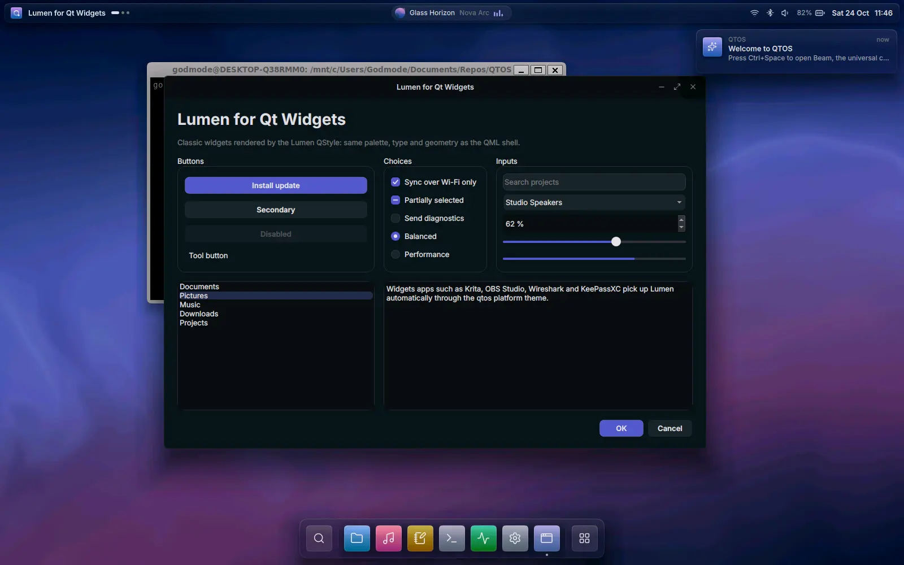

# Building and running QTOS

## 1. Prerequisites

### Windows (primary development platform)

| Tool | Version | Notes |
|------|---------|-------|
| Qt | **6.12.0**, kit `msvc2022_64` | Commercial install via Qt Maintenance Tool (see module list below) |
| Visual Studio 2022 or Build Tools | 17.14+ | Workload "Desktop development with C++" (MSVC v143, Windows SDK) |
| CMake | 3.27+ | Bundled with Qt: `C:\Qt\Tools\CMake_64` |
| Ninja | any recent | Bundled with Qt: `C:\Qt\Tools\Ninja` |
| Python | 3.10+ | Token generator, tests, tooling |
| Git | 2.40+ | |

### Required Qt modules

Install these for the `MSVC 2022 64-bit` kit in the Qt Maintenance Tool
(`C:\Qt\MaintenanceTool.exe` → Add or remove components → Qt 6.12.0):

| Component | Installer package | Needed for |
|-----------|-------------------|------------|
| Qt 6.12.0 MSVC 2022 64-bit | `qt.qt6.6120.win64_msvc2022_64` | Core, Gui, Qml, Quick, Quick Controls, Quick Effects, Quick Shapes, Svg, Test, Widgets |
| Qt Shader Tools | `qt.qt6.6120.addons.qtshadertools` | `qt_add_shaders` (`.frag` → `.qsb`) |
| Qt Remote Objects | `qt.qt6.6120.addons.qtremoteobjects` | Service IPC, `repc` |
| Qt Graphs | `qt.qt6.6120.addons.qtgraphs` | Monitor app |
| Qt Image Formats | `qt.qt6.6120.addons.qtimageformats` | WebP screenshots |
| Qt Quick Compiler extensions | `qt.qt6.6120.addons.qtqmlscriptcompiler` | `qmlsc` ahead-of-time QML compilation (commercial) |
| Qt Task Tree (TP) | `qt.qt6.6120.addons.qttasktree` | Dependency of Qt's own QML asset-downloader plugin; without it CMake prints a warning at configure time |

Recommended for upcoming phases (see [QT-MODULES.md](QT-MODULES.md)): Qt
Multimedia, Qt Quick 3D, Qt Quick Timeline, Qt Lottie, Qt Virtual Keyboard,
Qt WebEngine, Qt Spatial Audio, Qt Positioning, Qt TextToSpeech.

`cmake/QtosLocateQt.cmake` finds Qt automatically, in this order:
`Qt6_DIR`/`CMAKE_PREFIX_PATH` from your IDE kit, the `QTOS_QT_DIR`
environment variable, then `C:\Qt\6.12.0\msvc2022_64`.

### Linux

Qt 6.12.0 `gcc_64` with the same modules (plus **Qt Wayland Compositor** to
build `prism`), GCC 13+ or Clang 17+, CMake 3.27+, Ninja, and the
OpenGL/EGL/xkbcommon development packages:

```bash
sudo apt-get install ninja-build libgl1-mesa-dev libegl1-mesa-dev libxkbcommon-dev \
  libfontconfig1-dev libfreetype-dev libwayland-dev libpulse0 libssl-dev
```

`libpulse0` is needed by Qt Multimedia (the audio engine); desktops running
PipeWire are used through it automatically. `libssl-dev` (OpenSSL 3's
libcrypto) verifies Store signatures; Windows uses CNG instead.

### Linux on WSL2 (Windows workstation)

WSL2 with WSLg is the quickest way to work on the Linux-only parts (`prism`,
the platform plugins) from a Windows machine. It is verified on Ubuntu 26.04
with GCC 15 and CMake 4.2.

```bash
# 1. Build dependencies, plus Weston's demo clients for testing Prism:
sudo apt-get install build-essential cmake ninja-build git python3 pkg-config \
  libgl1-mesa-dev libegl1-mesa-dev libgles-dev libdrm-dev libgbm-dev libvulkan-dev \
  libxkbcommon-dev libxkbcommon-x11-dev libfontconfig1-dev libfreetype-dev libdbus-1-3 \
  libwayland-dev wayland-protocols libinput-dev libxcb-cursor0 libpulse0 libssl-dev weston

# 2. The commercial Qt kit, unattended. This reuses the Qt Account sign-in
#    from Windows. Copy it once and keep it private:
install -D -m 600 "/mnt/c/Users/<you>/AppData/Roaming/Qt/qtaccount.ini" ~/.local/share/Qt/qtaccount.ini
python3 /mnt/c/path/to/QTOS/tools/ci/install_qt.py --platform linux --root ~/Qt

# 3. Build the Windows checkout from WSL into the Linux filesystem (fast I/O).
#    Turn .qmlls.ini generation off so the Windows editor setup is untouched:
cmake -S /mnt/c/path/to/QTOS -B ~/qtos-build/linux-release --preset linux-release \
  -DQT_QML_GENERATE_QMLLS_INI=OFF
cmake --build ~/qtos-build/linux-release
ctest --test-dir ~/qtos-build/linux-release        # GPU suites run on WSLg too
```

On Linux the executables sit in their target directories, for example
`prism/qtos-shell`, `prism/compositor/prism` and `platform/lumen-widgets-gallery`.

## 2. Configure and build

The Ninja presets need the MSVC environment. `tools\dev\Enter-QtosShell.ps1`
loads it (via `vswhere` and `vcvars64.bat`) together with Qt's `bin`, CMake and
Ninja:

```powershell
. .\tools\dev\Enter-QtosShell.ps1          # dot-source once per terminal
cmake --preset windows-release
cmake --build --preset windows-release
ctest --preset windows-release
```

Or in one step: `.\tools\dev\build.ps1 [-Preset windows-debug] [-Test] [-Target all_qmllint] [-Fresh]`.

| Preset | Generator | Build type | Use |
|--------|-----------|------------|-----|
| `windows-release` | Ninja | RelWithDebInfo | Day-to-day work, benchmarks, screenshots |
| `windows-debug` | Ninja | Debug | Debugging (Qt debug DLLs) |
| `windows-vs` | Visual Studio 17 2022 | multi-config | Works without a developer shell |
| `linux-release`, `linux-debug` | Ninja | | Linux |
| `ci-windows`, `ci-linux` | Ninja | RelWithDebInfo | CI. Both treat warnings as errors |

Build options (`-D<option>=ON|OFF`):

| Option | Default | Effect |
|--------|---------|--------|
| `QTOS_BUILD_TESTS` | ON | Tests in `tests/` |
| `QTOS_BUILD_TOOLS` | ON | `qtosctl`, `qtos-simd` |
| `QTOS_BUILD_PLATFORM` | ON | QStyle plugin, platform theme, widgets gallery |
| `QTOS_BUILD_COMPOSITOR` | ON on Linux | `prism` (skipped with a warning if Qt Wayland Compositor is missing) |
| `QTOS_WARNINGS_AS_ERRORS` | OFF | `/WX` or `-Werror` |
| `QTOS_QT_PINNED_VERSION` | 6.12.0 | Version used by Qt auto-location |

Outputs (Windows): executables and test binaries in `build/<preset>/`, QML
modules in `build/<preset>/qml/`, plugins in `build/<preset>/plugins/`.

### IDEs

- **Qt Creator**: open `CMakeLists.txt`, choose the *Qt 6.12.0 MSVC2022 64bit* kit. Presets are detected.
- **VS Code**: open the folder and accept the recommended extensions (Qt
  extension pack, CMake Tools, clangd). Presets, launch configurations and
  tasks are in `.vscode/`.
- **Visual Studio**: use the `windows-vs` preset, or open the folder (CMake presets are supported).

## 3. Run

```powershell
.\tools\dev\run.ps1 [-Preset windows-release] -- <qtos-shell options>
```

`qtos-shell` options:

| Option | Description |
|--------|-------------|
| `--unlocked` | Start on the desktop instead of the lock screen |
| `--open <apps>` | Comma-separated apps to open after unlock: `files`, `music`, `notes`, `terminal`, `monitor`, `settings`. `app/page` opens a page and `app/page/section` scrolls to a section, for example `settings/sound/reactive` |
| `--play`, `--seek <seconds>` | Start the music, at a position |
| `--surface <name>` | Show `beam`, `control-center`, `overview` or `media` after start |
| `--query <text>` | Initial Beam query (with `--surface beam`) |
| `--theme light\|dark` | Force appearance (writes to the settings service) |
| `--accent <hue>` | Force accent hue in OKLCH degrees |
| `--contrast standard\|high` | Force Increase Contrast off or on |
| `--size WxH` | Window size in logical pixels (clamped to the screen) |
| `--fullscreen` | Start full screen (<kbd>F11</kbd> toggles) |
| `--services embedded\|external` | Host the simulator in-process (default) or connect to `qtos-simd` |
| `--services-url <url>` | Services endpoint |
| `--scenario <file>` | Simulation scenario JSON (default: built-in `sim/scenarios/default.json`) |
| `--ephemeral` | Do not persist preferences (implied by `--screenshot` and `--benchmark`) |
| `--gpu high-performance\|low-power\|default` | GPU preference (default `high-performance`) |
| `--screenshot <file> [--delay ms]` | Save a frame (`.webp`, `.png`, `.jpg`) and exit |
| `--benchmark <seconds> [--benchmark-out file]` | Scripted animation tour, prints frame-pacing JSON, exits |
| `--script <file>` | Drive the shell with a JSON script and exit ([DEVELOPMENT.md](DEVELOPMENT.md)) |

`--screenshot`, `--benchmark` and `--script` render audio silently (the
engine's null output; see [AUDIO.md](AUDIO.md)), see only virtual game
controllers (`QTOS_GAMEPADS=virtual`; see [CONTROLLERS.md](CONTROLLERS.md)),
leave the touchpad alone (`QTOS_TOUCHPAD=off`; see
[SHELL.md](design/SHELL.md#gestures)), and install from the Store into a
temporary folder (`QTOS_STORE_DIR`; see [STORE.md](STORE.md)).
`QTOS_STORE_URL` points the Store at another signed catalogue.

Persistent preferences (appearance, accent, motion, transparency, living
wallpaper, audio and the audio-reactive interface) are stored with `QSettings`
under `QOR-MATRIX/QTOS Shell` and Notes under the `notes` category.

### Separate service process

```powershell
.\build\windows-release\qtos-simd.exe --ephemeral            # terminal 1
.\tools\dev\run.ps1 -- --services external --unlocked       # terminal 2
.\build\windows-release\qtosctl.exe watch                    # terminal 3
```

### Prism, the Wayland compositor (Linux)

`prism` hosts the same shell as a real Wayland compositor. It runs nested
inside any Wayland or X11 session, including WSLg:

```bash
B=~/qtos-build/linux-release
$B/prism/compositor/prism --unlocked --socket wayland-qtos &
WAYLAND_DISPLAY=wayland-qtos weston-terminal &                  # client-side decorations
WAYLAND_DISPLAY=wayland-qtos QT_QPA_PLATFORM=wayland \
  $B/platform/lumen-widgets-gallery &                           # Qt app, Prism decorations
```



| Option | Description |
|--------|-------------|
| `--unlocked` | Start on the desktop instead of the lock screen |
| `--socket <name>` | Wayland socket for clients (default: the first free `wayland-N`, printed at start) |
| `--size WxH` | Output window size |
| `--outputs N` | Drive N outputs (up to 4), side by side, each a window of `--size`. On bare metal (`QT_QPA_PLATFORM=eglfs`) every connected screen is an output instead |
| `--spread-clients` | Open each new client on the output with the fewest windows |
| `--services embedded\|external` | As for `qtos-shell` |
| `--screenshot <file> [--delay ms]` | Save the output and exit (used for automated checks) |
| `--benchmark <seconds> [--benchmark-out file]` | Shell tour plus input latency; per-output JSON report, then exit ([PERFORMANCE.md](PERFORMANCE.md)) |

How clients are handled:

- **Decorations.** Clients that support `xdg-decoration` (all Qt apps) get
  Prism's title bar and controls. Clients that draw their own (Weston demos,
  GTK) get none, so nothing is drawn twice.
- **Window geometry.** A client's window geometry is aligned with the frame,
  and client-drawn shadows are clipped, never scaled.
- **Size.** If a client picks its own size (a preferred size on first map, or
  whole character cells in a terminal), the frame adopts it.
- **Window state.** Focus, maximise and minimise follow `xdg_toplevel`
  requests and states.
- **Moves.** A move started from a client's own title bar uses the same
  springs and edge snapping as Prism's.

Under WSLg, Mesa's `libEGL` warnings and "no EGL_WL_bind_wayland_display" are
expected. Clients fall back to shared-memory buffers, which is fine for
development; on device, GPU buffer sharing is part of Phase 2.

## 4. Tests and lint

```powershell
ctest --preset windows-release                       # all suites
ctest --preset windows-release -LE gpu               # skip GPU-dependent suites
cmake --build --preset windows-release --target all_qmllint
python tools\tokens\generate_tokens.py --check
python tools\ci\check_headers.py
.\.venv\Scripts\pre-commit run --all-files
```

## 5. Install and deploy

```powershell
cmake --install build\windows-release --prefix dist\qtos
```

The install step runs Qt's deployment script (`qt_generate_deploy_qml_app_script`,
which calls `windeployqt` on Windows) to produce a self-contained folder with
the required Qt libraries, plugins and QML modules. The result runs on a
machine without Qt installed (verified with an empty `PATH`).

Because the QTOS QML modules are static and embedded in the executable,
`qtos-shell` sets `QT_QML_IMPORT_SCANNER_EXTRA_ROOT_PATHS` to `kit/`, `apps/`
and `services/` so the deployment scan finds their imports (for example
`QtCore` and `QtGraphs`). Add new module directories there.

## 6. Troubleshooting

| Symptom | Fix |
|---------|-----|
| `Cannot open include file: 'rep_…_replica.h'` | Reconfigure; generated headers live in the build tree (`services/`, `tools/qtosctl/`) |
| Configure can't find Qt | Set `QTOS_QT_DIR` to the kit (`C:\Qt\6.12.0\msvc2022_64`) or pass `-DCMAKE_PREFIX_PATH=…` |
| `cl` not found with Ninja presets | Dot-source `tools\dev\Enter-QtosShell.ps1`, or use the `windows-vs` preset |
| No console output from `qtos-shell` | It is a GUI-subsystem app. Set `QT_FORCE_STDERR_LOGGING=1` and redirect stderr. Use `QT_LOGGING_RULES="qtos.*=true"` for QTOS categories |
| Test output missing in `ctest` | Tests set `QT_FORCE_STDERR_LOGGING=1`; run the binary with `-o -,txt` to see QtTest output directly |
| Low frame rate on a laptop | Check the log line `GPU: …`. Use `--gpu high-performance`, or force an adapter with `QT_D3D_ADAPTER_INDEX` (`QSG_INFO=1` lists adapters) |
| Shader or graphics issues | `QSG_INFO=1` prints the RHI backend and adapter; `QSG_RHI_BACKEND=vulkan\|opengl\|d3d12` switches backends |
| Services did not initialise in time | Another QTOS instance holds `local:qtos-services`. The host falls back to a PID-suffixed endpoint; pass `--services-url` to `qtosctl` |
